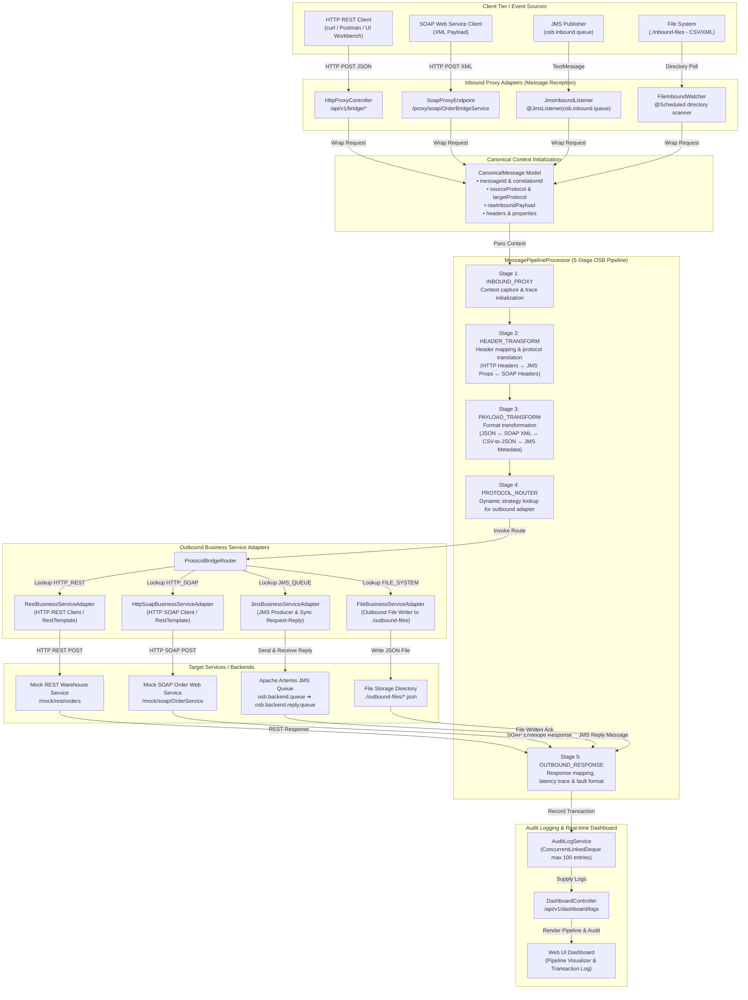
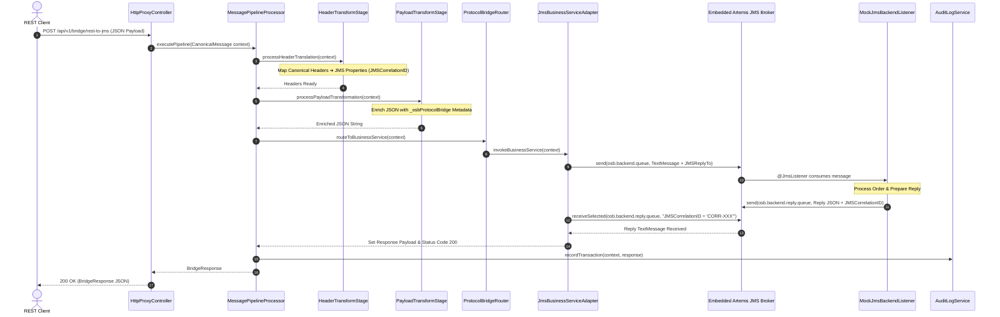
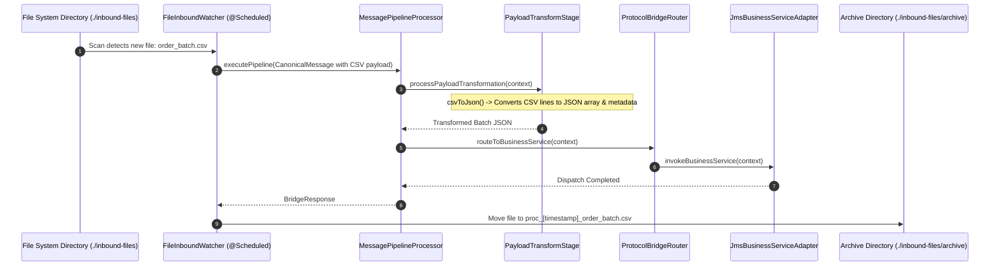

# Oracle Service Bus (OSB) Protocol Bridge Pattern - Application Flow & Architecture

This document provides a comprehensive end-to-end breakdown and visual flow diagrams of the **OSB Protocol Bridge Pattern** application. Built with Java 21 and Spring Boot 3.3.4, this Enterprise Integration Pattern (EIP) middleware decouples heterogeneous clients from legacy backend systems by normalizing incoming requests, executing protocol-level and payload transformations, and dynamically routing messages to target business services.

---

## 1. High-Level Architecture Flowchart

The diagram below illustrates the core architecture and message lifecycle across inbound proxy adapters, the normalized **Canonical Message** model, the 5-stage OSB pipeline, dynamic routing, outbound adapters, backend systems, and real-time audit logging.



---

## 2. End-to-End Sequence Diagrams

### 2.1 HTTP REST to SOAP Web Service Bridge Protocol Flow (`REST -> SOAP`)

In this scenario, a modern REST client sends a JSON payload to the bridge. The bridge transforms JSON into a SOAP 1.1 XML Envelope, invokes a legacy SOAP service, transforms the XML response back to JSON, and returns the response to the REST client.

```mermaid
sequenceDiagram
    autonumber
    actor Client as REST Client
    participant Controller as HttpProxyController
    participant Pipeline as MessagePipelineProcessor
    participant HeaderStage as HeaderTransformStage
    participant PayloadStage as PayloadTransformStage
    participant Router as ProtocolBridgeRouter
    participant SoapAdapter as HttpSoapBusinessServiceAdapter
    participant SoapBackend as MockBackendServiceController
    participant Audit as AuditLogService

    Client->>Controller: POST /api/v1/bridge/rest-to-soap (JSON Payload)
    Controller->>Pipeline: executePipeline(CanonicalMessage context)
    
    note over Pipeline: Stage 1: INBOUND_PROXY Init Trace
    Pipeline->>HeaderStage: processHeaderTranslation(context)
    note over HeaderStage: Stage 2: Inject X-Correlation-ID & SOAPAction
    HeaderStage-->>Pipeline: Headers Ready
    
    Pipeline->>PayloadStage: processPayloadTransformation(context)
    note over PayloadStage: Stage 3: jsonToSoapEnvelope() -> &lt;soapenv:Envelope&gt;
    PayloadStage-->>Pipeline: Transformed SOAP XML Payload

    Pipeline->>Router: routeToBusinessService(context)
    note over Router: Stage 4: Match ProtocolType.HTTP_SOAP
    Router->>SoapAdapter: invokeBusinessService(context)
    
    SoapAdapter->>SoapBackend: POST /mock/soap/OrderService (SOAP XML + SOAPAction)
    SoapBackend-->>SoapAdapter: 200 OK (SOAP Response XML Envelope)
    SoapAdapter-->>Pipeline: Set Response Payload & Status Code 200

    note over Pipeline: Stage 5: OUTBOUND_RESPONSE Mapping
    Pipeline->>Audit: recordTransaction(context, response)
    Audit-->>Pipeline: Audit Log Recorded
    Pipeline-->>Controller: BridgeResponse Object
    Controller-->>Client: 200 OK Response (BridgeResponse JSON with pipeline trace)
```

---

### 2.2 HTTP REST to JMS Queue Request-Reply Bridge Protocol Flow (`REST -> JMS`)

In this scenario, an HTTP REST request is converted to an ActiveMQ JMS TextMessage and published to `osb.backend.queue`. The adapter performs a synchronous request-reply using correlation ID matching on `osb.backend.reply.queue`.



---

### 2.3 File System Watcher Batch Inbound Bridge Flow (`FILE -> JMS / REST`)

In this scenario, the `@Scheduled` file watcher scans `./inbound-files` for CSV/XML files, converts CSV rows into structured JSON array records, processes the batch through the OSB pipeline, dispatches to JMS, and archives the file.



---

## 3. 5-Stage OSB Message Pipeline Mechanics

The central engine of the application is the `MessagePipelineProcessor`, which executes a strictly ordered 5-stage VETRO (Validate, Enrich, Transform, Route, Operate) pattern:

| Stage # | Stage Name | Component | Core Responsibilities |
| :--- | :--- | :--- | :--- |
| **Stage 1** | **Inbound Proxy Entry** | `MessagePipelineProcessor` | Captures message entry point, generates `messageId` and `correlationId` if missing, starts timer, and logs entry trace. |
| **Stage 2** | **Header Transformation** | `HeaderTransformStage` | Normalizes incoming headers into canonical header map; translates headers into protocol-specific metadata (e.g., `X-Correlation-ID`, `JMSCorrelationID`, `SOAPAction`, `Content-Type`). |
| **Stage 3** | **Payload Transformation** | `PayloadTransformStage` | Performs data conversion (JSON to SOAP XML Envelope, SOAP XML to JSON, CSV to JSON array, JSON metadata enrichment for JMS). |
| **Stage 4** | **Protocol Bridge Routing** | `ProtocolBridgeRouter` | Uses Strategy Pattern (`EnumMap<ProtocolType, BusinessServiceAdapter>`) to select and execute the corresponding outbound adapter (`Rest`, `Soap`, `JMS`, `File`). |
| **Stage 5** | **Outbound Response & Audit** | `AuditLogService` | Captures status code, status message, response payload, updates total execution time (ms), appends pipeline step traces, and logs transaction into in-memory queue. |

---

## 4. Project Component Mapping & Package Breakdown

```
com.hexaware.osb.protocolbridge
│
├── adapter
│   ├── inbound                     # Inbound Proxy Adapters (Protocol Entry Points)
│   │   ├── HttpProxyController.java      # REST endpoints (/api/v1/bridge/*)
│   │   ├── SoapProxyEndpoint.java        # SOAP endpoint (/proxy/soap/OrderBridgeService)
│   │   ├── JmsInboundListener.java       # JMS queue listener (osb.inbound.queue)
│   │   └── FileInboundWatcher.java       # Scheduled file scanner (./inbound-files)
│   │
│   └── outbound                    # Outbound Business Service Adapters (Target Protocol Bindings)
│       ├── BusinessServiceAdapter.java   # Adapter Strategy Interface
│       ├── RestBusinessServiceAdapter.java       # Outbound HTTP REST Client
│       ├── HttpSoapBusinessServiceAdapter.java   # Outbound HTTP SOAP Client
│       ├── JmsBusinessServiceAdapter.java        # Outbound JMS Producer & Sync Request-Reply
│       └── FileBusinessServiceAdapter.java       # Outbound File Writer
│
├── config
│   └── ActiveMQJmsConfig.java      # Embedded Apache Artemis JMS configuration & queue declarations
│
├── domain                          # Canonical Data Model & Request/Response Contracts
│   ├── CanonicalMessage.java       # Internal normalized OSB message context
│   ├── ProtocolType.java           # Protocol enum (HTTP_REST, HTTP_SOAP, JMS_QUEUE, FILE_SYSTEM)
│   ├── BridgeRequest.java          # REST API request payload model
│   ├── BridgeResponse.java         # REST API response model with pipeline execution trace
│   └── AuditLogEntry.java          # Audit log record model
│
├── exception
│   ├── ProtocolBridgeException.java      # Custom runtime fault with stage identification
│   └── GlobalBridgeExceptionHandler.java # Spring ControllerAdvice fault handler
│
├── mockbackend                     # Mock Downstream Target Services
│   ├── MockBackendServiceController.java # Mock REST (/mock/rest/orders) & SOAP (/mock/soap/OrderService)
│   └── MockJmsBackendListener.java       # Mock JMS consumer on osb.backend.queue
│
├── pipeline                        # OSB Core Pipeline Engine
│   ├── MessagePipelineProcessor.java     # 5-stage pipeline executor
│   ├── HeaderTransformStage.java         # Stage 2: Header translation
│   ├── PayloadTransformStage.java        # Stage 3: Payload conversion
│   └── ProtocolBridgeRouter.java         # Stage 4: Outbound strategy router
│
├── service
│   └── AuditLogService.java        # Sliding window transaction audit logger (max 100 entries)
│
└── ui
    └── DashboardController.java     # REST API serving audit logs & simulation triggers for UI dashboard
```

---

## 5. Protocol Transformation Matrix

| Source Protocol | Target Protocol | Payload Transformation Technique | Header Translation |
| :--- | :--- | :--- | :--- |
| **HTTP REST (JSON)** | **HTTP SOAP (XML)** | Converts JSON keys into XML tags inside a standard `<soapenv:Envelope>` & `<ord:ProcessOrderRequest>`. | Maps HTTP Headers ➔ `SOAPAction` & `Content-Type: text/xml`. |
| **HTTP SOAP (XML)** | **HTTP REST (JSON)** | Parses XML tags (`<orderId>`, `<status>`, `<customer>`, `<amount>`) and constructs structured JSON. | Maps SOAP Headers ➔ HTTP Headers & `Content-Type: application/json`. |
| **HTTP REST (JSON)** | **JMS Queue** | Injects `_osbProtocolBridge` metadata (`correlationId`, `bridgedAt`, `sourceProtocol`) into JSON body. | Maps HTTP Headers ➔ JMS Properties (`JMSCorrelationID`, `JMSType`). |
| **File System (CSV)** | **JMS Queue / REST** | Reads CSV header row and transforms CSV data lines into a JSON array wrapped in a batch payload. | Injects `FileName` and `SourceSystem: FileWatcher` into headers. |
| **JMS Queue** | **HTTP REST (JSON)** | Reads TextMessage body, passes through payload to HTTP REST endpoint. | Maps JMS Message Properties ➔ HTTP Request Headers (`JMS_Property`). |
